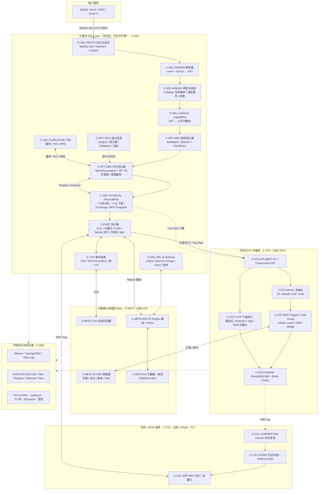
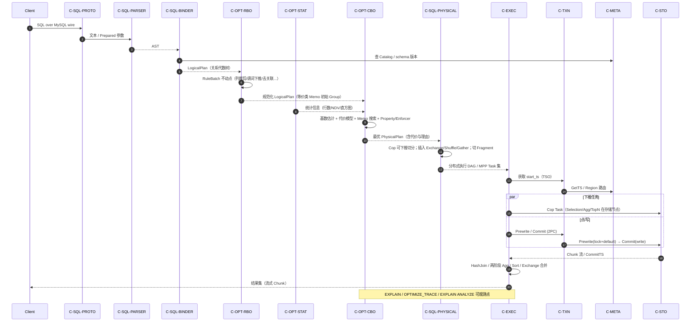
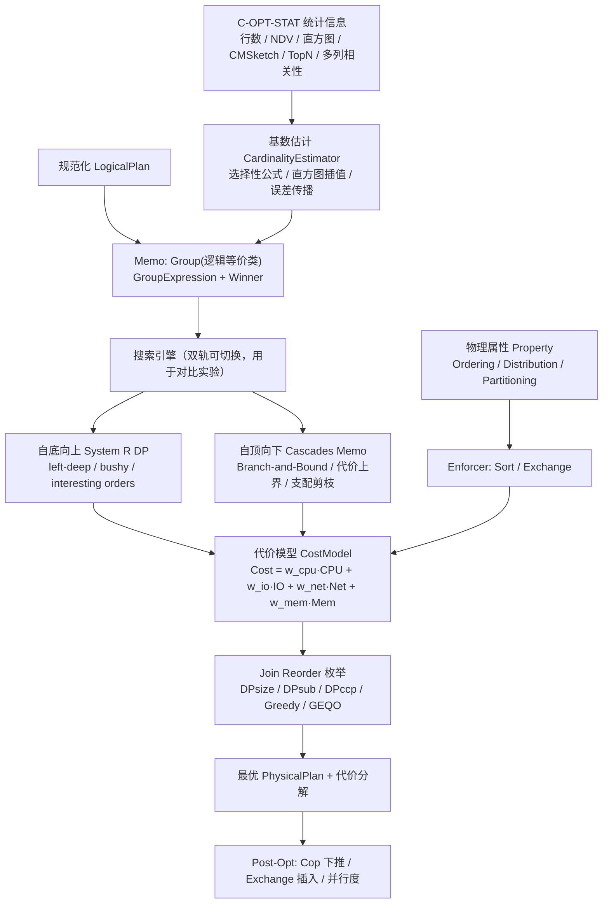

# 01 架构设计（Architecture Design）

> 状态：`[设计]` ｜ 版本：v0.1 ｜ 适用：LatticeDB 全阶段 ｜ 上游：无 ｜ 下游：02 概要设计、04 功能点列表、05 验收规划

---

## 1. 目标、非目标与约束

### 1.1 目标（Goals）

1. **架构保真**：复现工业级分布式 HTAP 数据库的核心分层与关键机制，使在其上得到的实验结果具备外部有效性（external validity），可迁移到真实系统讨论。
2. **可拆解教学/研究**：每个子系统可独立启用、独立测量、独立关闭（用于消融实验），以 Lab 形式递进构建（见 03）。
3. **优化器与执行器为第一公民**：算子集合、执行计划表示、RBO/CBO 具备完整可观测接口（`EXPLAIN`、`OPTIMIZE_TRACE`、代价分解、规则命中日志），是本项目的主要研究载体。
4. **可复现与可度量**：所有性能与正确性结论必须附带环境、种子、数据集、置信区间与基线对比（见 05 §7）。
5. **Rust 全栈实现**：内存安全、零拷贝列式数据、异步 IO、无 GC 停顿，便于做细粒度性能归因。

### 1.2 非目标（Non-Goals，明确裁剪）

| 不做 | 理由 / 替代 |
| --- | --- |
| 100% MySQL 语法/协议兼容 | 仅覆盖实验室子集（见 04 §F-SQL），用 sqllogictest 与 MySQL 对拍限定范围 |
| 生产级多租户、计费、云管控 | 属平台工程，非研究变量 |
| 自研 LSM-Tree / 自研 Raft | 单机引擎用 RocksDB，共识用 raft-rs；研究重点在计算层与优化器 |
| 存储过程、触发器、物化视图自动改写、全文检索、GIS | 超出 48 周范围，列为 P2 / `[研究向]` |
| 跨地域多活、异地容灾 | 单集群单地域，多副本容错足够支撑实验 |

### 1.3 约束

- **人力假设**：1 名博士研究生（可辅以若干课程 Lab 学生），48 周有效工期（见 03）。
- **硬件基线**：单机开发（≥16C/32G/NVMe）；分布式实验用 3–8 节点容器/云主机，网络 10Gbps 或等价，配置固化到 `bench/env.toml`。
- **正确性基线**：MySQL 8.0（语义）、TiDB（分布式计划形态）、DuckDB/PostgreSQL（结果对拍）。
- **许可与依赖**：Apache-2.0 / MIT 系依赖，避免 GPL 污染。

---

## 2. 质量属性与非功能目标（可度量）

| 属性 | 指标 | 目标阈值 | 验收 |
| --- | --- | --- | --- |
| 正确性 | sqllogictest / 差分测试通过率 | 100%，P0 用例零回归 | 05 V2 |
| 优化器质量 | TPC-H 22 查询相对 RBO 基线几何平均加速 | ≥ 2.0×（CBO 全开） | 05 AC-CBO |
| 基数估计 | q-error p95 / max | ≤ 10 / ≤ 1e3（TPC-H skew 集） | 05 AC-CBO |
| 向量化 | 列式 vs 行式单算子吞吐 | ≥ 3×（Scan/Filter/Agg/HashJoin） | 05 AC-OP |
| 线性扩展 | 4 节点 MPP 相对单节点加速（TPC-H SF=100） | ≥ 2.8× | 05 V4 |
| 事务 | TPC-C tpmC 线性度、SI 异常注入检出率 | 异常检出 100% | 05 V3 |
| 可用性 | Leader 故障切换 RTO / RPO | RTO ≤ 10s / RPO = 0 | 05 V3 |
| 稳定性 | 72h 混沌压测无数据错乱、无未处理 panic | 0 例 | 05 V3 |
| 可观测 | 任一慢查询可产出含代价分解的 `EXPLAIN ANALYZE` | 100% | 05 AC-PLAN |
| 可复现 | 基准实验重跑相对偏差 | ≤ 5%（同环境，≥5 次） | 05 §7 |

---

## 3. 分层架构总览

### 3.1 架构图



### 3.2 三条正交的数据通路

| 通路 | 触发 | 路径 | 关键设计点 |
| --- | --- | --- | --- |
| **OLTP 点通路** | 点查 / 单点写入 / 主键更新 | `PROTO → PARSER → BINDER → PointGet/BatchPointGet → TXN(2PC) → KVAPI(1 RPC) → MVCC/RAFT` | 绕过优化器主路径（`Fast Plan`），P99 延迟优先 |
| **OLAP 查询通路** | 扫描/连接/聚合 | `… → RBO → CBO(Memo) → PhysicalPlan(含 Cop 下推 + Exchange) → MPP Fragment → 多节点并行` | 优化器质量、下推边界、网络代价、倾斜处理 |
| **后台通路** | DDL / Analyze / Split / GC / 调度 | `DDL/STAT/SCHED → 元数据版本变更 → Region 状态机 → 异步应用` | 在线变更、版本一致性、可回滚 |

### 3.3 组件清单（`C-` 编号，与 04/05 追溯）

| ID | 组件 | 职责 | 有状态 | 对标 |
| --- | --- | --- | --- | --- |
| C-SQL-PROTO | 协议与会话 | MySQL wire、连接/鉴权、Session 变量、Prepared Statement | 连接级 | TiDB server |
| C-SQL-PARSER | 解析器 | 词法/语法 → AST，错误恢复，多方言开关 | 无 | TiDB parser / sqlparser-rs |
| C-SQL-BINDER | 绑定校验 | 名称解析、类型推导与隐式转换、权限、AST→LogicalPlan | 无 | Calcite SqlValidator |
| C-OPT-RBO | 规则优化器 | 等价变换规则批、模式匹配、不动点迭代 | 无 | Calcite HepPlanner |
| C-OPT-STAT | 统计信息 | 采样、直方图、NDV/CMSketch/TopN、过期与自动收集 | 持久化 | TiDB statistics |
| C-OPT-CBO | 代价优化器 | Memo 搜索、基数估计、代价模型、物理属性、Join Reorder | 无 | Cascades / Orca |
| C-SQL-PHYSICAL | 物理计划与分布式化 | 物理算子选择、Cop 可下推判定、Exchange 插入、Fragment 切分 | 无 | TiDB planner/core |
| C-SQL-PLANCACHE | 计划治理 | Plan Cache、Hint、SPM/Baseline、Plan Replayer | 缓存 | TiDB plan cache |
| C-EXEC | 执行器 | 算子实现、向量化 Chunk、并行调度、内存/Spill、结果返回 | 查询级 | Volcano / Hyper / DuckDB |
| C-TXN | 事务协调 | 快照获取、2PC、锁冲突、ResolveLock、GC、隔离级别 | 事务级 | Percolator |
| C-DDL | DDL/Schema | Online DDL、schema 版本、lease、元数据锁 | 版本状态 | TiDB DDL |
| C-META-TSO | 时间戳服务 | 全局单调 TSO（批量分配 + 高可用） | 逻辑时钟 | PD TSO |
| C-META-ROUTE | 路由 | Region → Store 映射、客户端 cache、重试与 backoff | 缓存 | PD / TiDB region cache |
| C-META-SCHED | 调度 | 副本均衡、热点调度、Split/Merge 决策、Operator 队列 | 全局视图 | PD scheduler |
| C-META-HA | 元数据 HA | 元数据自身多副本一致（内嵌 Raft） | 有 | PD etcd |
| C-STO-API | 存储 RPC | KV Get/BatchGet/Prewrite/Commit/Raw & Txn API、Cop Task 协议 | 无 | TiKV kvproto |
| C-STO-MVCC | MVCC | `key@ts` 编码、三类 CF、快照读、锁解析、GC safe point | 有 | Percolator |
| C-STO-RAFT | 共识与分片 | Region/Raft Group、Leader Lease、Split/Merge、Snapshot | 有 | TiKV raftstore |
| C-STO-ENGINE | 单机引擎 | RocksDB 封装、CF 配置、Block Cache、Compaction 调优 | 有 | RocksDB |
| C-STO-COP | 存储下推 | 可下推表达式/Selection/Agg/TopN/Limit 的向量化执行 | 无 | TiKV coprocessor |
| C-COL-LEARNER | 列存复制 | Raft Learner 异步日志复制，行→列转换，一致性校验读 | 有 | TiFlash |
| C-COL-STORE | 列存引擎 | 列式段存 + Delta 增量、粗粒度索引、向量化扫描 | 有 | TiFlash DeltaTree |
| C-COL-MPP | MPP 执行 | 列存侧 Fragment/Exchange/两阶段 Join&Agg | 无 | TiFlash MPP |
| C-OBS | 可观测 | Metrics/Tracing/Slow log/诊断/实验设施 | 时序数据 | Prometheus/OTel |

---

## 4. 计算层：SQL 全生命周期（架构视角）



**快路径（Fast Plan）**：`PointGet` / `BatchPointGet` / 简单 `INSERT ... VALUES` 在 Binder 之后直接生成物理计划，跳过 RBO/CBO，保证 OLTP 延迟（04 `F-PLAN-001`）。

---

## 5. 算子体系（核心重点 ①）

算子分为四层：`逻辑算子`（关系代数）→ `物理算子`（算法实现）→ `交换/并行算子`（分布式）→ `表达式与向量化原语`（算子内部计算）。完整编号清单见 **04 §4**，此处给出架构约束。

### 5.1 设计约束

1. **统一接口**：所有物理算子实现同一 `Executor` trait（`open / next_chunk / close`），返回列式 `Block{Chunk}`；算子组合即执行 DAG，便于替换实现做消融。
2. **物理属性可传递**：每个算子声明 `required_property`（排序 `Ordering`、分布 `Distribution`、分区）与 `delivered_property`，供 CBO 的 Enforcer 机制使用（见 §6.4）。
3. **算子可观测**：每个 `next_chunk` 记录行数、耗时、内存峰值、Spill 次数，聚合进 `EXPLAIN ANALYZE`（05 AC-OP-001）。
4. **可降级**：HashJoin/Agg/Sort 在内存超限时必须可切 `Grace Hash Join` / `External Merge Sort` / `Spill`，降级行为纳入验收（04 `F-OP-021`）。
5. **NULL / 三值逻辑 / 溢出语义**：所有算子遵循统一 `DataType` 规则，禁止算子内各自处理。

### 5.2 算子族总览（架构级）


### 5.3 Join 的物理实现矩阵（研究重点）

| 场景 | 候选实现 | CBO 决策依据 | 关键变量 |
| --- | --- | --- | --- |
| 小表 ⋈ 大表（等值） | Broadcast HashJoin vs Shuffle HashJoin | 小表字节数 vs `broadcast_threshold`、网络代价 | 倾斜、Build 侧内存 |
| 双大表等值 | Shuffle HashJoin vs SortMergeJoin | NDV、是否已排序（interesting order）、Spill 代价 | 数据倾斜、排序复用 |
| 有索引、外表很小 | IndexJoin / IndexHashJoin | 外表基数 × 单次索引查找代价 | 回表随机 IO |
| 非等值 / 笛卡尔 | NestedLoopJoin / BlockNLJ | 无非等值替代时的下界 | 必须显式上界保护 |
| Semi / Anti | Semi HashJoin / Null-Aware Anti Join | 子查询形态、NULL 语义 | `NOT IN` 的 NULL 正确性 |
| 相关子查询 | Apply → 去关联 → Join/Agg | RBO 去关联是否成功 | 相关性列、去重 |
| 大表超内存 | Grace Hash Join / 动态分区 + Spill | 内存配额、行数估计误差 | Spill IO、递归分区 |

---

## 6. 执行计划与优化器（核心重点 ②）

### 6.1 三种计划形态

| 形态 | 内容 | 载体 |
| --- | --- | --- |
| **LogicalPlan** | 关系代数树，无算法、无顺序、无分布概念 | `PlanNode` + `Schema` + `Expression` |
| **PhysicalPlan** | 选定算法（HashJoin…）、物理属性、代价 | `PhysicalPlanNode` + `Cost` + `Stats` |
| **Distributed Plan / DAG** | 切分为 `Fragment`（含 Cop Task、Exchange、MPP Task、并行度） | `PlanFragment` + `Task` + `ExchangeSpec` |

计划转换链：`AST → LogicalPlan →(RBO)→ 规范化 LogicalPlan →(CBO)→ PhysicalPlan →(Post-Opt)→ Distributed DAG → Executor Builder`。

### 6.2 RBO：规则优化器架构（C-OPT-RBO）

- **规则表示**：`Rule { name, pattern(树模式 + 谓词 guard), transform, promise }`，`TransformationRule` 与 `ImplementationRule` 分离（后者归 CBO）。
- **执行模型**：`RuleBatch` 顺序批 + 批内 `FixedPoint` 不动点迭代；`Once / ApplyOnce / Iterate` 三种策略；收敛性由规则只做「降低代数复杂度」的偏序保证（`[待标定]` 需设最大迭代轮数与循环检测）。
- **规则分类**（完整清单见 04 §5）：
  - 化简类：常量折叠、表达式化简、谓词推导（等值传递闭包）、冗余算子消除（投影/排序/去重/Limit 合并）。
  - 下推类：谓词下推（含外连接/聚合/窗口的边界）、列裁剪、Limit/TopN 下推、聚合下推、分区裁剪、索引条件下推 ICP。
  - 重写类：子查询去关联（Apply→Join）、`IN/EXISTS→SemiJoin`、`NOT IN→Null-Aware Anti Join`、外连接消除/转内连接、Join 消除（PK/FK/唯一约束）、`OR→UNION`、Max/Min 与 `COUNT(*)` 特化、CTE 内联/物化决策。
  - 正确性护栏：所有规则必须有「关系代数等价 + bag 语义 + NULL 三值逻辑」的证明或反例测试（05 AC-RBO）。
- **可观测**：`OPTIMIZE_TRACE` 记录每条规则命中次数、前后计划 diff、耗时，支撑消融实验（关闭单规则测收益）。

### 6.3 CBO：代价优化器架构（C-OPT-CBO）



- **统计信息**：`ANALYZE` 全量/采样（Reservoir / Bernoulli）、等高/等宽/混合直方图、CMSketch、TopN、多列组合统计与函数依赖、索引统计、自动收集与过期判定（`modify_count / row_count` 比例）。
- **基数估计（CE）**：单表选择性（等值/范围/IN/LIKE/IS NULL/AND/OR/NOT）、Join 选择性 `1/max(NDV_l, NDV_r)`、直方图桶内插值、多列独立假设误差与上下界裁剪；**q-error 作为一等公民指标**（05 §5.2），支持 `estimate feedback` 闭环修正 `[研究向]`。
- **代价模型**：`Cost = w_cpu·C_cpu + w_io·C_io + w_net·C_net + w_mem·C_mem`，各算子给出可微/可解释公式（如 HashJoin `≈ c_b·|R| + c_p·|S| + c_h·hash`，IndexLookUp `≈ index_scan + sel·rowid_lookup·random_io`，Sort `≈ N·logN + spill_io`）；代价常数通过标定实验确定（05 §5.3），支持分机型配置。
- **搜索空间**：System R 自底向上 DP（保留 interesting orders 与物理属性）与 Cascades 自顶向下 Memo **双实现并存**，用于论文级对比（枚举完备性、剪枝效率、规划耗时 vs 计划质量的 Pareto）。
- **Join Reorder**：`DPsize / DPsub / DPccp`（连通子图枚举，避免笛卡尔积）、贪心、遗传/GEQO 作为大查询（>16 表）兜底；处理外连接/Semi/Anti 的重排序约束、bushy vs left-deep。
- **物理属性与 Enforcer**：`required property` 未满足时插入 `Sort` / `Exchange`，并把 Enforcer 代价计入 Winner 选择；分布式属性包括 `HashPartitioned(keys)`、`Broadcast`、`SinglePartition`、`Ordered`。
- **分布式代价**：Cop 下推收益（返回行数减少 × 网络节省 − 存储节点 CPU），Broadcast vs Shuffle 的网络字节，倾斜惩罚项，Fragment 并行度与启动开销。

### 6.4 Plan 治理与稳定性（C-SQL-PLANCACHE）

| 机制 | 作用 | 编号 |
| --- | --- | --- |
| `EXPLAIN` / `FORMAT=brief\|verbose\|json\|dot` | 计划可读输出 | `F-PLAN-002` |
| `EXPLAIN ANALYZE` | 实际行数/耗时/内存/回流，与估计对比 | `F-PLAN-003` |
| `OPTIMIZE_TRACE` / 规则命中日志 | 优化过程白盒 | `F-PLAN-004` |
| Plan Cache（参数化 + 失效） | 降低 OLTP 规划开销 | `F-PLAN-006` |
| Hint 体系（`USE_INDEX / HASH_JOIN / LEADING / AGG_TO_COP / READ_FROM_STORAGE …`） | 强制干预 | `F-PLAN-007` |
| SPM / Baseline 绑定 | 防计划回归 | `F-PLAN-008` |
| Plan Replayer / 计划回归回放 | 现场复现 | `F-PLAN-009` |
| 代价分解可视化 | 论文图表数据源 | `F-PLAN-010` |

---

## 7. 分布式 KV 存储层（C-STO）

### 7.1 Key 编码（保序，概要见 02 §4）

```
Table record :  t | table_id(int64, memcomparable) | "_r" | handle(主键, memcomparable)
Unique index:  t | table_id | "_i" | index_id | idx_value | handle
Non-unique  :  t | table_id | "_i" | index_id | idx_value | handle(保证唯一)
MVCC        :  对 user_key 追加 @start_ts（倒序编码，使最新版本排在最前）
```

- **三类 CF**（RocksDB Column Family）：`default`（长值）、`lock`（事务锁）、`write`（提交版本：`start_ts → commit_ts` 及 `Put/Delete/Rollback` 类型）。
- **Region**：`[start_key, end_key)` 为调度与 Raft 复制单位，默认 96MiB 触发 Split；Region 元数据由 C-META 维护，客户端缓存 + 版本重试。
- **Coprocessor 下推**：`DAGRequest` 携带 `Selection / Aggregation / TopN / Limit / 表达式`；下推白名单与「不可下推」回退规则在 02 §6 定义；下推任务同样产出 Chunk，与上层同构。

### 7.2 事务模型（Percolator 2PC）

`GetTS(start_ts) → Prewrite（写 lock + default，检查 write-write 冲突与 commit_ts > start_ts）→ Commit（写 write，删 lock）→ 返回`。读按 `start_ts` 做快照 MVCC 读，遇锁走 `ResolveLock`。悲观事务额外加 `PessimisticLock`（`SELECT … FOR UPDATE`）。隔离级别：默认 **SI (Snapshot Isolation)**，RC 与 SSI 列为 `[研究向]`（05 V5）。

### 7.3 一致性读写

- 写：Raft Leader 提交 → apply → 返回；读：支持 **Leader Lease / ReadIndex** 线性读与 `start_ts` 快照读；列存 Learner 读需等待复制进度（`resolved_ts`）。

---

## 8. 元数据与调度层（C-META）

| 能力 | 说明 |
| --- | --- |
| TSO | `physical(ms) << 18 | logical`，批量预分配时间窗口，主备切换保证单调 |
| 路由 | Region meta（epoch、leader、peers）+ 客户端 Region Cache，遇到 `EpochNotMatch / NotLeader` 触发 backoff 重试 |
| 调度 |  balancer（leader/region 计数）、hot-region（读写热点打散）、replica 补齐、Split/Merge、Operator 限流 |
| HA | 元数据自身 Raft 组；调度器无状态，可重选主 |

---

## 9. HTAP 与行列自动选择（P1，C-COL）

- 列存作为 **Raft Learner** 异步复制，不参与投票，不影响 OLTP 提交延迟；通过 `resolved_ts` 提供一致性读。
- 优化器将「行存 / 列存 / 混合」纳入代价模型：`READ_FROM_STORAGE` Hint 与自动选择并存；列存侧支持 MPP `Exchange` 与两阶段聚合。
- 研究问题：行列混合计划的代价估计、新鲜度（freshness）与查询性能的权衡曲线（05 §5.6）。

---

## 10. 技术选型（Rust Workspace）

| 层 | 选型 | 理由 |
| --- | --- | --- |
| 语言 / 运行时 | Rust 2021+ / tokio | 无 GC、异步 IO、所有权保障 Chunk 零拷贝 |
| Parser | 自研（nom/pest + 手写 Pratt 表达式解析）或 sqlparser-rs 扩展 | 需要可控 AST 与错误恢复 |
| RPC | tonic + prost（对齐 kvproto 自研 proto） | gRPC 流式 Cop/MPP |
| 单机引擎 | RocksDB binding（`rocksdb` crate） | 工业级 LSM，CF 原生支持 |
| 共识 | raft-rs（TiKV 同源） | Raft 正确性经过验证 |
| 列式内存 | 自研 `Block/Chunk`（Arrow 语义 + SelectionVector） | 向量化与零拷贝可控 |
| 表达式加速 | SIMD（`std::arch` / `arrow` 思路）+ 可选 Cranelift JIT | 可消融对比 |
| 可观测 | `tracing` + OpenTelemetry + Prometheus | 与实验脚本打通 |
| 基准 | criterion / sqllogictest / TPC 工具 / SQLancer(Rust 移植) / Porcupine 线性检查 | 验收即代码 |

Crate 划分（`Cargo workspace`）：`common · types · expr · parser · catalog · planner · optimizer(rbo+cbo+stats) · executor · coprocessor · storage · raftstore · meta · server · bench · tests`。**依赖方向单向**：`server → executor → optimizer → planner → types`，禁止反向依赖；每 crate 有独立 trait 边界，便于 mock 与消融（02 §3）。

---

## 11. 部署形态

| 形态 | 用途 | 拓扑 |
| --- | --- | --- |
| `embedded`（单进程） | L0–L4 单元/算子实验、`cargo test` | 内存 KV + 单节点执行器 |
| `standalone` | L5–L9 端到端 SQL、优化器实验 | 1×SQL + 1×Meta + 3×Store（单进程多角色或容器） |
| `cluster` | L10+ 分布式/MPP/混沌/基准 | ≥3×Store + ≥2×SQL + 3×Meta + 可选 2×Column |
| `bench` | 论文实验 | 固化 `bench/env.toml`：节点规格、网络、数据集 SF、重复次数、种子 |

所有形态共用同一二进制，通过 `--role` 与配置切换，保证实验结论可跨形态迁移。

---

## 12. 关键架构决策（ADR 摘要）

| # | 决策 | 备选 | 理由 | 可反转性 |
| --- | --- | --- | --- | --- |
| ADR-1 | 逻辑/物理/分布式计划三态分离 | 单棵树原地改写 | 可观测、可缓存、可回放，优化器研究必需 | 低 |
| ADR-2 | CBO 双引擎（DP + Cascades Memo）并存 | 仅 Cascades | 支撑对比实验与论文，代价是维护成本 | 中 |
| ADR-3 | 火山模型 + 列式 Chunk（拉模式）为主，Morsel 并行叠加 | 全推送 / 全编译执行 | 实现可控、易做算子级消融；Codegen 作为可开关加速层 | 高 |
| ADR-4 | 自研 KV 编码 + RocksDB，不自研 LSM | 自研存储 | 聚焦计算层研究变量，避免无关工程黑洞 | 中 |
| ADR-5 | 统计信息/代价常数全部配置化、可注入 | 硬编码 | 消融与标定实验前提，可复现性要求 | 高 |
| ADR-6 | 所有优化规则可独立开关并留痕 | 固定规则批 | 单规则收益归因、计划回归定位 | 高 |
| ADR-7 | 列存为 Learner 副本而非独立写入链路 | 双写 | 不污染 OLTP 路径，新鲜度可建模 | 中 |

---

## 13. 研究问题地图（博士选题，`[研究向]`）

| 编号 | 问题 | 可证伪假设 / 实验 | 关联 |
| --- | --- | --- | --- |
| RQ-1 | 在分布式代价模型下，Cascades Memo 相对 System R DP 的「规划时间–计划质量」Pareto 边界 | 同一 TPC-DS 查询集对比枚举数、剪枝率、几何平均执行时间 | §6.3 · L8/L14 · M3/M6 |
| RQ-2 | 基数估计误差沿计划树的传播规律与 q-error 上界 | 注入误差，测估计误差 → 次优计划的概率模型 | §6.3 · L7/L14 · M3/M6 |
| RQ-3 | 学习式基数估计 / 学习式代价（轻量模型）在分布漂移下的鲁棒性 | 与直方图/CMSketch 基线对比，训练外分布的退化曲线 | §6.3 · L15 · M7 |
| RQ-4 | Runtime Filter / 自适应连接（AQE）对倾斜数据的收益上界 | Zipf 倾斜数据集上消融 | §5.3 · L12 · M5 |
| RQ-5 | 行列混合计划的自动选择：新鲜度约束下的代价下界 | freshness–latency 权衡曲线 | §9 · L13 · M5 |
| RQ-6 | 向量化 + SIMD + JIT 三层加速各自的边际收益 | 逐层消融 + roofline 归因 | §5 · L10 · M5 |
| RQ-7 | 优化器规则子集的「最小充分集」 | 逐规则消融，求保持 95% 性能的最小规则集合 | §6.2 · L6/L14 · M3/M6 |

---

## 14. 与 TiDB 的对照及裁剪边界

| 维度 | TiDB | LatticeDB | 裁剪说明 |
| --- | --- | --- | --- |
| SQL 层 | Go，完整 MySQL 兼容 | Rust，教学/研究子集 | 保留优化器与执行器全结构，裁剪语法面 |
| 优化器 | Cascades-like + 规则批 + 统计 | DP 与 Memo 双实现、全可观测 | 更偏研究：暴露搜索过程与代价分解 |
| 执行 | 火山 + 向量化 + MPP | 同构，额外可开关 JIT/Spill | 算子级消融接口为新增 |
| 存储 | TiKV(Rust) | 自研薄层 + RocksDB + raft-rs | 保留 MVCC/Cop/Region 语义，简化调度 |
| 元数据 | PD | 内嵌 TSO/路由/调度 | 单 Raft 组，简化 HA |
| HTAP | TiFlash | Learner + 列存 + MPP（P1） | 保留行列自动选择研究点 |
| 生态 | BR/TiCDC/DM/权限/审计 | 最小权限 + CDC 基础（P2） | 见 04 §F-ECO |

> **有效性声明**：本库不追求与 TiDB 性能绝对值可比，而是保证**机制同构、变量可控、结论可迁移**；所有对比实验须以「同基线、同数据集、同环境」呈现，禁止跨系统裸比（05 §7.4）。
