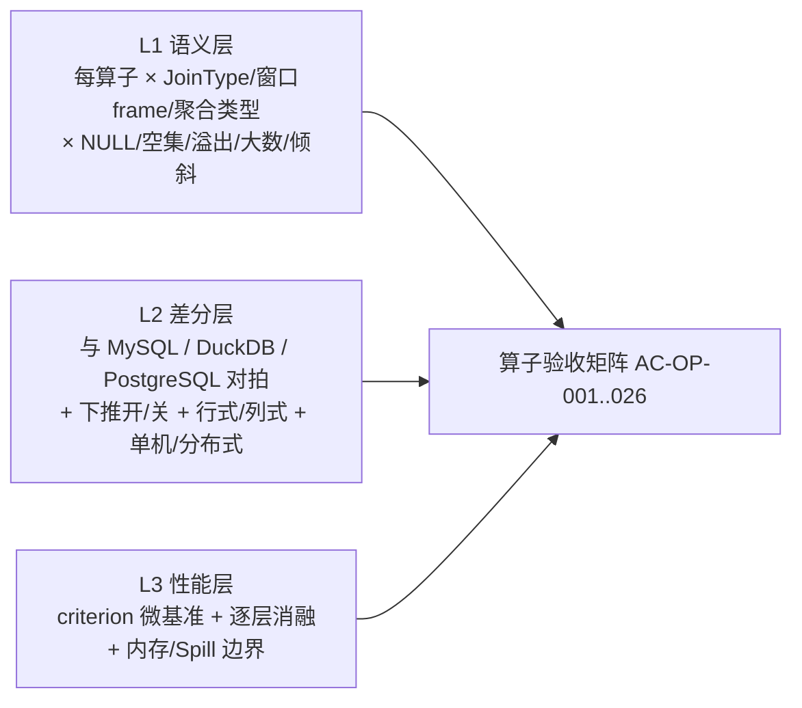

# 05 功能验收规划（Acceptance & Validation Plan）

> 状态：`[设计]` ｜ 版本：v0.1 ｜ 上游：01–04 ｜ 本文是 M0–M7 门禁与论文实验的唯一验收依据
>
> 核心原则：**每条功能点有验收项、每个验收项有量化阈值、每个性能结论有可复现实验**。算子、执行计划、RBO/CBO 四块设专项验收（§5–§7）。

---

## 1. 验收组织

| 角色 | 职责 |
| --- | --- |
| 开发者 | 自检（V0–V2）、提交用例与实验元数据 |
| CI 门禁 | 自动执行 V0–V2 + 计划回归 + 追溯检查，失败阻断合并 |
| 里程碑评审 | M0–M7 按 §10 门禁逐条核验 `AC-*`，抽查实验可复现性 |
| 实验复核 | 论文相关结论（V5）由第二人按 §9 独立重跑 |

**验收证据**：每条 `AC-*` 必须产出可归档证据（测试报告 / 基准 JSON / 计划 diff / trace / 混沌日志），统一落在 `artifacts/<M*>/<AC-*>/`，由 `F-OBS-012` 自动附带环境、种子、版本、配置。

---

## 2. 验收等级 V0–V5

| 等级 | 名称 | 范围 | 执行方式 | 关联里程碑 |
| --- | --- | --- | --- | --- |
| **V0** | 单元与静态 | 编译、clippy、单测、依赖方向、追溯完整性、格式化 | CI 每次提交 | 全阶段 |
| **V1** | 模块/接口 | 类型、表达式、逻辑计划、trait mock、计划序列化 | CI + 单测 | M1 |
| **V2** | 单节点端到端 | SQL 正确性、全算子、sqllogictest、差分对拍、单节点事务 | CI + 集成测试 | M1, M2 |
| **V3** | 分布式与一致性 | Raft/2PC/MVCC、故障注入、线性一致性、崩溃恢复、混沌 | 专用集群 + 模拟器 | M5 |
| **V4** | 优化器与性能 | CE/代价/搜索、TPC-H/DS、向量化、MPP 扩展、HTAP、计划治理 | 固化基准环境 | M3, M4, M5 |
| **V5** | 论文级 / 可复现 | 全矩阵、消融、置信区间、72h 长稳、artifact 独立重跑 | 实验复核 | M6, M7 |

**晋级规则**：高等级通过的前提是其所依赖的低等级全绿；任一 `P0` 功能点的 `AC-*` 未达标，对应里程碑不得放行。

---

## 3. 量化阈值总表（全局硬指标）

| 类别 | 指标 | 阈值 | 验收项 |
| --- | --- | --- | --- |
| 正确性 | sqllogictest / 差分用例通过率 | 100%，P0 零回归 | AC-TEST-003/004 |
| 正确性 | SQLancer（TLP/NoREC/PQS）发现的错误 | 0 未修复 | AC-TEST-005 |
| 优化器 | TPC-H 22 查询几何平均加速（CBO 全开 vs RBO 基线） | ≥ 2.0× | AC-CBO-014 |
| 优化器 | TPC-H 灾难性计划数（定义 §6.2） | 0 | AC-CBO-014 |
| 优化器 | 基数估计 q-error p95 / max | ≤ 10 / ≤ 1e3 | AC-CBO-006 |
| 优化器 | 代价与实际耗时 Spearman 相关 | ≥ 0.7 | AC-CBO-007 |
| 优化器 | 规划时间（TPC-DS 99 查询 p95） | ≤ 500 ms | AC-CBO-014 |
| 规则 | 每条 RBO 规则等价性证明/反例覆盖 | 100% | AC-RBO-001 |
| 算子 | 列式 vs 行式单算子吞吐 | ≥ 3× | AC-OP-023 |
| 算子 | OOM 降级（Spill）正确率 / 泄漏 | 100% / 0 | AC-OP-021 |
| 计划 | 下推开/关结果一致率 | 100% | AC-PLAN-005 |
| 计划 | Plan Cache 命中正确率 / SPM 防回归 | 100% / 100% | AC-PLAN-006/008 |
| 分布式 | 4 节点 MPP 加速（TPC-H SF=100） | ≥ 2.8× | AC-EXEC-013 |
| 分布式 | Leader 切换 RTO / RPO | ≤ 10 s / = 0 | AC-STO-006 |
| 事务 | SI/RC 异常注入检出率 | 100% | AC-TXN-002 |
| 一致性 | 线性一致性检查（Porcupine）违例 | 0 | AC-TXN-008 |
| 稳定性 | 72h 混沌压测数据错乱 / 未处理 panic | 0 / 0 | AC-TEST-008 |
| 可复现 | 基准重跑相对偏差（≥5 次） | ≤ 5% | AC-BENCH-009 |
| 可观测 | 任一慢查询可出含代价分解的 `EXPLAIN ANALYZE` | 100% | AC-PLAN-003/004 |

---

## 4. 验收项总表 `AC-*`（按域）

> 列：`编号 | 验收对象 | 方法 | 通过标准（量化） | 等级 | Lab/里程碑`。所有编号与 04 引用一一对应。

### 4.1 AC-SQL · 协议与解析

| 编号 | 对象 | 方法 | 通过标准 | 等级 | Lab |
| --- | --- | --- | --- | --- | --- |
| AC-SQL-001 | F-SQL-001/002/010/016, F-ECO-001 | `mysql` CLI / JDBC 连接、握手、查询、错误码对拍 | 100 条协议用例通过；结果集与 MySQL 逐字节比对 | V2 | L5 |
| AC-SQL-002 | F-SQL-003/004 | Session 变量与 Prepared 参数化用例 | 变量隔离；影响计划的变量进入 cache key | V2 | L5 |
| AC-SQL-003 | F-SQL-005/006/013 | Parser 用例集 + fuzz | 合法 SQL 100% 解析；非法 SQL 100% 报错且带位置 | V1 | L1 |
| AC-SQL-004 | F-SQL-007/009/011, F-DDL-011, F-ECO-009 | 名称解析/权限/歧义/元数据查询用例 | 与 MySQL 语义对拍 500 例全通过 | V2 | L1/L5 |

### 4.2 AC-TYP · 类型与表达式

| 编号 | 对象 | 方法 | 通过标准 | 等级 | Lab |
| --- | --- | --- | --- | --- | --- |
| AC-TYP-001 | F-TYP-001 | DataType 全覆盖单测 | 每类型构造/序列化/比较通过 | V1 | L1 |
| AC-TYP-002 | F-TYP-002, F-OP-023 | Block/Column/Validity 单测 + 零拷贝检查 | 无多余拷贝（计数器断言） | V1 | L1 |
| AC-TYP-003 | F-TYP-003 | Decimal 精度/溢出/除零矩阵 | 与 MySQL DECIMAL 对拍 1000 例 | V1 | L1 |
| AC-TYP-004 | F-TYP-004/008/017, F-ECO-012 | 时间/时区/CAST 矩阵对拍 | 1000 例全通过；无时区漂移 | V1 | L1 |
| AC-TYP-005 | F-TYP-005 | NULL / 三值逻辑真值表 | 全组合与参考库一致 | V1 | L1 |
| AC-TYP-006 | F-TYP-006/009 | 标量函数集对拍（数值/字符串/日期/JSON/条件） | 每函数 ≥50 例通过；确定性/可下推元数据正确 | V2 | L1 |
| AC-TYP-007 | F-TYP-007, F-SQL-012 | Collation 比较与排序一致性（上下层同实现） | 上下层结果 100% 一致 | V2 | L1 |
| AC-TYP-008 | F-TYP-014/015 | Vector 类型 / UDF 框架 | 基础用例通过（P2，不阻断门禁） | V5 | L15 |

### 4.3 AC-DDL · DDL 与 Schema

| 编号 | 对象 | 方法 | 通过标准 | 等级 | Lab |
| --- | --- | --- | --- | --- | --- |
| AC-DDL-001 | F-DDL-001/002/009, F-PART-009 | DDL 语句用例（含分区） | 全部 DDL 可执行且元数据正确 | V2 | L11 |
| AC-DDL-002 | F-DDL-003/004/005/013 | 在线 DDL 状态机 + 并发 DML 注入 | 任意状态切换期间读写 100% 正确；无旧版本读到新 schema 错乱 | V3 | L11 |
| AC-DDL-003 | F-DDL-006/007, F-IDX-014 | Job 幂等/回滚/重放 + ADD INDEX 回填 | 注入失败后重放结果一致 | V3 | L11 |
| AC-DDL-004 | F-DDL-008/010 | 元数据锁、约束、DDL/DML 并发 | 无死锁、无约束违例漏检 | V3 | L11 |
| AC-DDL-005 | F-DDL-015 | 元数据升级兼容用例 | 跨版本可读（P2） | V5 | L15 |

### 4.4 AC-TXN · 事务与一致性

| 编号 | 对象 | 方法 | 通过标准 | 等级 | Lab |
| --- | --- | --- | --- | --- | --- |
| AC-TXN-001 | F-TXN-001/002 | 事务生命周期 + TSO 单调性 | 100 万次 GetTS 严格单调；崩溃切换后不回退 | V2 | L4/L11 |
| AC-TXN-002 | F-TXN-003/004/019 | SI/RC 隔离级别异常注入（脏读/不可重复读/幻读/写偏斜） | 检出率 100%；无违例 | V3 | L4/L11 |
| AC-TXN-003 | F-TXN-005/006/007/008 | 2PC 各阶段正确性 + 写冲突 | 冲突用例 100% 按预期提交/回滚 | V2 | L4 |
| AC-TXN-004 | F-TXN-009/010/018 | 1PC / 分布式 2PC / 只读优化 | 跨 Region 事务 1000 例原子性通过 | V3 | L11 |
| AC-TXN-005 | F-TXN-011/017 | 冲突重试、死锁检测 | 无活锁；死锁 100% 检出并回滚 | V3 | L4/L11 |
| AC-TXN-006 | F-TXN-012/013/014 | ResolveLock、TTL、大事务 | 锁遗留 0；大事务 100 万行成功 | V3 | L11 |
| AC-TXN-007 | F-TXN-015, F-STO-010 | GC safe point 与活跃快照 | 不删除任何活跃快照所需版本（历史读用例） | V3 | L11 |
| AC-TXN-008 | F-TXN-019/020, F-TEST-018 | 线性一致性（Porcupine）+ SSI + Async Commit | 历史记录违例 0；SSI 写偏斜检出 100% | V5 | L15 |

### 4.5 AC-OP · 算子（专项见 §5）

| 编号 | 对象 | 方法 | 通过标准 | 等级 | Lab |
| --- | --- | --- | --- | --- | --- |
| AC-OP-001 | OP-L-DATASOURCE/PROJECTION/SELECTION/DUAL, OP-P-DUAL/MAXONEROW | 逻辑算子构造 + Schema 推导 + 基础物理算子 | 100% 用例通过 | V1 | L2 |
| AC-OP-002 | OP-L-JOIN-* / OP-P 逻辑连接族 | JoinType × NULL × 空集矩阵 | 全组合与参考库一致 | V2 | L2/L3 |
| AC-OP-003 | OP-L-APPLY/MAXONEROW/OP-P-APPLY | 相关子查询执行 | 与去关联后结果一致 | V2 | L3 |
| AC-OP-004 | OP-L-AGG/EXPAND/DISTINCT | 聚合/分组集结果 | 与 DuckDB 对拍 500 例 | V2 | L3 |
| AC-OP-005 | OP-L-WINDOW/SORT/TOPN/LIMIT | 窗口/排序/TopN 结果含 NULLS 与 Collation | 与参考库一致 | V2 | L3 |
| AC-OP-006 | OP-L-UNION/INTERSECT/EXCEPT/CTE/PARTUNION/SEQUENCE | 集合与 CTE（含递归） | 100% 用例通过 | V2 | L2/L3 |
| AC-OP-007 | OP-L-LOCK/DML/DDL + OP-P DML | DML 计划与执行 | 结果/索引/约束 100% 正确 | V2 | L3 |
| AC-OP-008 | OP-P 扫描类（含 IndexLookUp/IndexMerge） | 差分对拍 + 回表正确性 | 100% 结果一致；回表次数符合估计 | V2 | L3/L9 |
| AC-OP-009 | OP-P 点查/采样/列存/CTE/UnionScan | 点查、固定种子采样、读己之写 | 100% 通过；采样可复现 | V2 | L5/L13 |
| AC-OP-010 | OP-P-HASHJOIN/MERGEJOIN/NLJ/CARTESIAN/BLOCKNLJ | Join 正确性 + 边界 + 上界保护 | 全矩阵通过；笛卡尔超限被拒 | V2 | L3 |
| AC-OP-011 | OP-P-INDEXJOIN/INDEXHASHJOIN | 索引连接正确性 | 与 HashJoin 结果一致 | V2 | L3 |
| AC-OP-012 | OP-P-BROADCASTHJ/SHUFFLEHJ | 分布式 Join 正确性（含倾斜） | 与单机结果一致；无数据丢失/重复 | V3 | L12 |
| AC-OP-013 | OP-P-SEMIJOIN/NAAJ/OUTERSEMI | **`NOT IN` + NULL 三值逻辑专项** | 与 MySQL 全组合一致（重点防错） | V2 | L3 |
| AC-OP-014 | OP-P 聚合族 + OP-X-AGGFUNC/APPROX | 聚合函数/两阶段/近似 | 两阶段与单阶段结果一致；近似误差有界 | V2 | L3/L12 |
| AC-OP-015 | OP-P-SORT/EXTERNALSORT/TOPN/LIMIT/MERGESORT | 排序稳定性、Collation、大数外排 | 与参考库一致；外排结果一致 | V2 | L3/L10 |
| AC-OP-016 | OP-P-UNION/INTERSECT/EXCEPT | 集合语义（含 ALL / DISTINCT） | 100% 对拍 | V2 | L3 |
| AC-OP-017 | OP-P-WINDOW + OP-X-WINFUNC | 窗口 frame（ROWS/RANGE/GROUPS） | 与 DuckDB 对拍 300 例 | V2 | L3 |
| AC-OP-018 | OP-P-MATERIALIZE | 物化复用与内存释放 | 无重复计算、无泄漏 | V2 | L3 |
| AC-OP-019 | OP-P DML/SELECTLOCK/索引维护 | 增删改 + 索引一致性 + 锁 | checksum 校验 100% | V2 | L3 |
| AC-OP-020 | OP-P 管理/诊断算子 | Analyze/CheckTable/SHOW/Trace/LoadData | 用例通过（P2 项不阻断） | V2 | L7/L9 |
| AC-OP-021 | **Spill / Grace HJ / 外排 / 可溢写聚合** | 强制低内存配额触发降级 | 结果与非降级一致；Spill IO 计量准确；无 OOM/泄漏 | V3 | L10 |
| AC-OP-022 | RuntimeFilter / AdaptiveJoin | 倾斜（Zipf）数据集消融 | 结果一致；收益有量化记录 | V4 | L12 |
| AC-OP-023 | OP-X-BLOCK/VECEVAL/SELVECTOR/ZEROCOPY/VALIDITY | 向量化正确性 + 零拷贝 | 与行式结果 100% 一致 | V2 | L10 |
| AC-OP-024 | OP-X-SIMD/JIT/DICT/EXPRCACHE | 逐层消融 + 正确性 | 各层结果一致；列式 vs 行式 ≥ 3× | V4 | L10 |
| AC-OP-025 | F-OP-025 算子观测埋点 | `EXPLAIN ANALYZE` 字段完整性 | actual_rows/耗时/内存/spill 100% 可采 | V2 | L3/L9 |
| AC-OP-026 | F-OP-026 边界矩阵 | NULL/空集/溢出/大数/倾斜/超长字符串 | 全矩阵通过，无 panic | V2 | L3/L10 |

### 4.6 AC-RBO · 规则优化（专项见 §6.1）

| 编号 | 对象 | 方法 | 通过标准 | 等级 | Lab |
| --- | --- | --- | --- | --- | --- |
| AC-RBO-001 | R-CF/CP/SIMPLIFY, F-RBO-001/004/011, F-TEST-013 | 等价性证明 + metamorphic 测试 + 差分 | 每条规则 100% 有证明或反例；变换前后结果一致 | V2 | L6 |
| AC-RBO-002 | R-PRED-DEDUCE | 谓词推导用例 | 推导不产生假谓词（无结果差异） | V2 | L6 |
| AC-RBO-003 | R-COLPRUNE | 列裁剪前后结果一致 | 100% 一致；输出 Schema 正确 | V2 | L6 |
| AC-RBO-004 | R-PPD 全族（含外连接/聚合/窗口边界） | **边界用例集 + 差分测试** | 全部 200 例结果一致；外连接 ON/WHERE 无误下推 | V2 | L6 |
| AC-RBO-005 | R-LIMIT-PD/TOPN-PD/AGG-PD | 下推改写前后结果一致 | 100%（含并列与 OFFSET） | V2 | L6 |
| AC-RBO-006 | R-PART-PRUNE/DYN-PRUNE/ICP/INDEXMERGE, F-RBO-010, F-PART-004/005 | 裁剪结果集与未裁剪对拍 | 100% 一致；裁剪率有记录 | V2 | L6/L9/L12 |
| AC-RBO-007 | 消除/合并类规则 | 前后结果一致 | 100% | V2 | L6 |
| AC-RBO-008 | 特化类规则（MAX/MIN、COUNT(*)、EXISTS→Limit1） | 结果与语义等价 | 100%，含空表与 NULL | V2 | L6 |
| AC-RBO-009 | R-JOIN-ELIM/OUTER2INNER/OUTER-ELIM, F-IDX-011 | 约束驱动重写正确性 | 100%；无错误消除 | V2 | L6 |
| AC-RBO-010 | **R-DECORRELATE / IN / EXISTS / NAAJ / 标量子查询** | 相关子查询专项集（≥300 例） | 去关联前后结果一致；NAAJ NULL 语义正确 | V2 | L6 |
| AC-RBO-011 | 重写类其余规则 | 对拍 | 100% | V2 | L6 |
| AC-RBO-012 | 规则引擎不动点/收敛/开关/留痕 + 最小充分集（RQ-7） | 收敛测试 + 逐规则消融 | 所有规则可独立开关；`OPTIMIZE_TRACE` 留痕完整；消融数据可复现 | V4 | L6/L14 |

### 4.7 AC-CBO · 代价优化（专项见 §6.2）

| 编号 | 对象 | 方法 | 通过标准 | 等级 | Lab |
| --- | --- | --- | --- | --- | --- |
| AC-CBO-001 | CB-ANALYZE/SAMPLE/NDV, F-CBO-001, F-DDL-014 | 采样偏差测试（固定种子） | 估计行数相对误差 ≤ 5%（大表） | V2 | L7 |
| AC-CBO-002 | CB 直方图/TopN/CMSketch/多列/索引统计 | 构造已知分布验证估计 | 等值/范围选择性误差 ≤ 15% | V2 | L7 |
| AC-CBO-003 | 自动收集 / 过期判定 / 增量 | 触发条件与并发 DML | 统计不过期；后台不阻塞前台 | V2 | L7 |
| AC-CBO-004 | 反馈闭环 / 统计扰动注入 | 注入偏差测鲁棒性 | q-error 随扰动退化曲线可量化（RQ-2 数据） | V4 | L14 |
| AC-CBO-005 | 基数估计器（选择性/插值/误差传播/上下界） | 已知基数查询集（TPC-H + 合成） | 单表/Join 估计符合公式；无越界估计 | V4 | L7 |
| AC-CBO-006 | q-error 监控、倾斜检测、CE 误差基准 | TPC-H + skew 集全量采集 | **p95 ≤ 10，max ≤ 1e3**；看板可出分位数 | V4 | L7/L14 |
| AC-CBO-007 | 全算子代价公式 + 权重标定 + 代价分解 | 标定实验（微基准回归） | **代价与实际耗时 Spearman ≥ 0.7**；常数可复现 | V4 | L7 |
| AC-CBO-008 | System R DP | 枚举完备性 + 最优性（小规模穷举对比） | 与穷举最优计划一致 | V4 | L8 |
| AC-CBO-009 | Cascades Memo（Group/Winner/剪枝） | Memo Dump 校验 + 剪枝率统计 | 不丢失候选；Winner 代价非劣于 DP | V4 | L8 |
| AC-CBO-010 | 物理属性与 Enforcer | 排序/分布属性传递用例 | Enforcer 插入正确且代价计入 | V4 | L8 |
| AC-CBO-011 | Join Reorder 枚举族 + 重排约束 | 3–12 表查询集 + 外连接/Semi 约束 | 无非法重排；连通子图枚举无笛卡尔积 | V4 | L8 |
| AC-CBO-012 | 搜索预算 / 超时 / 回退 | 强制超时与大模型查询 | 100% 在预算内返回可用计划并留痕 | V4 | L8 |
| AC-CBO-013 | 分布式代价（Cop/Broadcast/Exchange/行列/并行度） | 决策正确性 + 代价对比 | 选择与实测更优方案一致率 ≥ 90% | V4 | L8/L9/L13 |
| AC-CBO-014 | 双引擎对比 + 计划质量基线 + 灾难性计划 | TPC-H 22 / TPC-DS 99 全量 | **几何平均加速 ≥ 2.0×；灾难性计划 0；规划 p95 ≤ 500ms** | V4 | L8/L14 |
| AC-CBO-015 | 估计/代价可注入与复现 | 同查询 × 不同配置消融 | 配置全部经 `OptimizerConfig` 生效且记录 | V4 | L8/L14 |

### 4.8 AC-PLAN · 执行计划（专项见 §7）

| 编号 | 对象 | 方法 | 通过标准 | 等级 | Lab |
| --- | --- | --- | --- | --- | --- |
| AC-PLAN-001 | Fast Plan | 点查/批量点查/简单 INSERT 走快路径 | 命中率 100%；结果与全路径一致 | V2 | L5 |
| AC-PLAN-002 | EXPLAIN 三态 + 多格式 | 输出解析与结构校验 | 三态可读、格式合法（`dot`/`json` 可解析） | V2 | L2/L9 |
| AC-PLAN-003 | EXPLAIN ANALYZE / FOR CONNECTION | 字段完整性 + 与实际计数核对 | actual_rows/耗时/内存/spill/网络 100% 可采且误差 ≤ 1% | V2 | L9 |
| AC-PLAN-004 | OPTIMIZE_TRACE / Memo Dump / 代价分解 / ChosenReason | 结构化输出校验 | 规则命中、Winner 理由、cpu/io/net/mem 分解齐全 | V4 | L9 |
| AC-PLAN-005 | Cop 下推判定 / Exchange 插入 / Fragment / 序列化 / **下推开-关一致性** | 差分测试 + 计划结构断言 | **下推开/关结果 100% 一致**；序列化往返无损 | V3 | L9/L12 |
| AC-PLAN-006 | Plan Cache / Prepared / 失效 | 命中率与正确性 + schema/stats 变更注入 | 命中正确率 100%；变更即失效 | V2 | L9 |
| AC-PLAN-007 | Hint 全项 + 索引 Hint | 逐 Hint 生效断言 | 每条 Hint 100% 生效并有 trace | V2 | L9 |
| AC-PLAN-008 | SPM / Baseline / Plan Replayer / 可回放性 | 现场打包 → 异环境回放 | 计划 100% 复现；基线可阻断回归 | V4 | L9 |
| AC-PLAN-009 | 计划回归门禁 / plan hash / 稳定性 | CI plan diff + 同 SQL 重复执行 | 无数据变化时计划不变；回归被阻断 | V4 | L9/L14 |
| AC-PLAN-010 | AQE 重优化 / 留痕 / 代价可视化导出 | 基数偏差注入 | 重优化触发正确，前后计划留痕可导出 | V4 | L12/L14 |
| AC-PLAN-011 | F-PLAN-011/012 下推与版本绑定契约 | 差分 + 回放 | 下推一致性、版本绑定可回放 100% | V3 | L9/L12 |

### 4.9 AC-EXEC · 执行引擎与分布式

| 编号 | 对象 | 方法 | 通过标准 | 等级 | Lab |
| --- | --- | --- | --- | --- | --- |
| AC-EXEC-001 | Executor trait / Builder | 算子组合与 mock 用例 | 100% 通过 | V1 | L3 |
| AC-EXEC-002 | 列式执行路径（可开关） | 与行式对拍 | 结果 100% 一致 | V2 | L10 |
| AC-EXEC-003 | Morsel 并行 | 线程数 × 数据规模矩阵 | 结果一致；加速比有记录 | V4 | L10 |
| AC-EXEC-004 | MemoryTracker / 配额 | 超限注入 | 超限被拒或降级，不 OOM | V3 | L10 |
| AC-EXEC-010 | Exchange 收发 / Gather / PassThrough | 多 Fragment 用例 | 无丢失/重复/乱序违约 | V3 | L12 |
| AC-EXEC-011 | Shuffle 全族 + 倾斜处理 | 哈希/范围/广播 + Zipf | 分区正确；倾斜不产生长尾节点 | V3 | L12 |
| AC-EXEC-012 | Cop Task / 局部聚合 / TopN / 两阶段正确性 | 与全上拉结果对拍 | 100% 一致 | V3 | L12 |
| AC-EXEC-013 | MPP Task / Dispatcher / 并行度 / 扩张性 | TPC-H SF=100 4 节点 | **加速 ≥ 2.8×** | V4 | L12 |
| AC-EXEC-014 | Pipeline / 背压 / 算子融合 | 背压与取消注入 | 无死锁、无泄漏 | V3 | L10/L12 |
| AC-EXEC-015 | 资源组 / 限流 / 超时 / 取消 / 连接治理 | 并发压力 + 客户端断连 | 资源 100% 释放 | V3 | L5/L12 |
| AC-EXEC-016 | 分类重试 / 幂等 / 故障重发 / 诊断上下文 | EpochNotMatch、NotLeader、RPC 超时注入 | 结果幂等；错误信息含 sql_id/plan_id/region_id/ts | V3 | L11/L12 |

### 4.10 AC-STO · 存储层

| 编号 | 对象 | 方法 | 通过标准 | 等级 | Lab |
| --- | --- | --- | --- | --- | --- |
| AC-STO-001 | 保序编码 + Key 布局 | 保序性/往返/边界（含 NULL、负零、超长） | 字节序与数值序 100% 一致 | V1 | L4 |
| AC-STO-002 | RocksDB / CF 配置 | 读写与重启 | 数据不丢；CF 隔离正确 | V2 | L4 |
| AC-STO-003 | KV API / MemoryKV | 全 API 用例 | 100% 通过 | V2 | L4 |
| AC-STO-004 | 写入限流 / 背压 | 高压注入 | 无写失败、无雪崩 | V3 | L11 |
| AC-STO-005 | Region 定义 / epoch | 边界与 epoch 变更 | 路由正确 | V3 | L11 |
| AC-STO-006 | Raft Group / Leader Lease / **故障切换** | Leader kill / 网络分区 / 线性读 | **RTO ≤ 10s，RPO = 0**；无脑裂 | V3 | L11 |
| AC-STO-007 | Split / Merge / Snapshot / 崩溃恢复 | 并发事务下 Split + 随机 kill | 数据一致；恢复后无损坏 | V3 | L11 |
| AC-STO-008 | 副本校验 / checksum | 主从比对 | 不一致检出率 100% | V3 | L14 |
| AC-STO-009 | Coprocessor 协议 / DagRequest / 存储侧求值 | 协议 fuzz + 对拍 | 与上层 `expr` 结果 100% 一致 | V3 | L12 |
| AC-STO-010 | GC / SST 导入 / 存储指标 | 长稳 + 批量导入 | 版本清理安全；指标齐全 | V3 | L11/L14 |

### 4.11 AC-META · 元数据与调度

| 编号 | 对象 | 方法 | 通过标准 | 等级 | Lab |
| --- | --- | --- | --- | --- | --- |
| AC-META-001 | TSO 批量分配 / HA / 单调性 | 主备切换 + 高并发 GetTS | 严格单调，切换不回退 | V3 | L11 |
| AC-META-002 | Region 路由 / 客户端 cache | 命中率与一致性 | 路由 100% 正确 | V3 | L11 |
| AC-META-003 | 元数据 Raft HA | 多数派故障注入 | 可用且一致 | V3 | L11 |
| AC-META-004 | 均衡 / 热点 / 副本 / 心跳 / 故障检测 | 倾斜负载 + 节点上下线 | 副本数达标；热点被识别打散 | V3 | L11 |
| AC-META-005 | Split 决策 / Operator 限流 / Placement / 运维命令 | 调度轨迹校验 | 无振荡、无限流失效 | V3 | L11 |

### 4.12 AC-IDX / AC-PART / AC-HTAP

| 编号 | 对象 | 方法 | 通过标准 | 等级 | Lab |
| --- | --- | --- | --- | --- | --- |
| AC-IDX-001 | 主键 / 聚簇 / 唯一索引 | 冲突与 NULL 语义 | 100% 对拍 MySQL | V2 | L2/L11 |
| AC-IDX-002 | 二级/联合/覆盖/IndexLookUp/IndexMerge | 回表与交并正确性 | 100% 结果一致 | V2 | L3/L9 |
| AC-IDX-003 | Index Range 构造 | 等值/范围/IN/前缀 LIKE 矩阵 | 100% 命中预期 range | V2 | L3 |
| AC-IDX-004 | 表达式/前缀索引、可见性、约束元数据 | 用例 | 100%（P2 不阻断） | V5 | L15 |
| AC-PART-001 | Range/Hash/List 分区 | 建表与路由 | 数据落位 100% 正确 | V2 | L6 |
| AC-PART-002 | 分区路由/写入/分区索引 | 对拍 | 100% | V2 | L11 |
| AC-HTAP-001 | Learner 复制 / 扩缩容 | 日志回放一致性 | 与行存一致 | V3 | L13 |
| AC-HTAP-002 | resolved_ts 一致性读 / 校验读 | 并发写入下读 | 无脏读、无版本回退 | V3 | L13 |
| AC-HTAP-003 | 列存段存 / Delta / ZoneMap | 过滤正确性 + 压缩比记录 | 100% 一致 | V3 | L13 |
| AC-HTAP-004 | 行列统一代价与自动选择 | 决策与实测对比 | 一致率 ≥ 90% | V4 | L13 |
| AC-HTAP-005 | 列存 MPP | 与行存 MPP 对拍 | 结果一致 | V4 | L13 |
| AC-HTAP-006 | 新鲜度 / OLTP 延迟隔离 | freshness–latency 曲线 + A/B | 列存同步不增加 OLTP P99（≤5% 波动） | V4 | L13/L14 |

### 4.13 AC-OBS / AC-TEST / AC-BENCH / AC-ECO / AC-RSH

| 编号 | 对象 | 方法 | 通过标准 | 等级 | Lab |
| --- | --- | --- | --- | --- | --- |
| AC-OBS-001 | Metrics 体系 | 指标完整性检查 | 每层指标齐全 | V2 | L0 |
| AC-OBS-002 | Tracing 贯穿 | span 链路完整性 | SQL→算子→RPC 链路可串 | V2 | L9 |
| AC-OBS-003 | Slow Log / SQL 摘要 / TopSQL | 归一化正确性 | 100% | V2 | L5 |
| AC-OBS-004 | 存储/调度指标 | 完整性 | 100% | V2 | L9 |
| AC-OBS-005 | 诊断页 / 告警 | 用例 | 可定位锁等待/热点 | V5 | L15 |
| AC-TEST-001 | 单测与 mock | crate 级单测 | 覆盖率门禁（P0 模块 ≥ 80%） | V0 | L0 |
| AC-TEST-002 | CI 门禁 / 依赖方向 / 追溯检查 / 覆盖率 | CI 流水线 + `check_traceability` | 全绿；追溯缺口 0 | V0 | L0/L14 |
| AC-TEST-003 | sqllogictest | 基础集 + 扩展集 | 100% 通过 | V2 | L5 |
| AC-TEST-004 | 多参考库差分 | MySQL/PostgreSQL/DuckDB 对拍 | 100% 一致 | V2 | L3/L14 |
| AC-TEST-005 | SQLancer TLP/NoREC/PQS + 随机 SQL + fuzz | 24h 连续运行 | 未修复错误 0 | V4 | L14 |
| AC-TEST-006 | 确定性分布式模拟器 | 事件序列重放 | 100% 可复现 | V3 | L11 |
| AC-TEST-007 | 混沌工程（kill/分区/时钟/磁盘满） | 注入矩阵 | 无数据错乱 | V3 | L14 |
| AC-TEST-008 | 72h 长稳压测 | 混合 OLTP/OLAP + 故障注入 | 数据错乱 0；未处理 panic 0 | V5 | L14 |
| AC-TEST-009 | 计划 diff / 回归基线 | CI 校验 | 回归 0 | V4 | L14 |
| AC-TEST-010 | 崩溃恢复用例 | 随机 kill | 恢复后一致 | V3 | L11 |
| AC-TEST-011 | 覆盖率门禁 | 统计 | 达标 | V0 | L14 |
| AC-TEST-012 | 验收矩阵自动校验 | 脚本 | 100% | V0 | L14 |
| AC-TEST-013 | 等价性/metamorphic 测试 | 用例集 | 100% | V2 | L6 |
| AC-TEST-014 | 一致性 checksum / 副本比对 | 全量校验 | 不一致检出 100% | V3 | L14 |
| AC-BENCH-001 | TPC-H / TPC-DS | 全量 22/99 查询 | 结果校验通过；性能达 §3 阈值 | V4 | L8/L14 |
| AC-BENCH-002 | TPC-C / sysbench / YCSB | 标准跑分 | tpmC 线性度、P99 记录完整 | V4 | L14 |
| AC-BENCH-003 | 算子级微基准 | criterion | 逐算子基线可用 | V4 | L3/L10 |
| AC-BENCH-004 | 倾斜数据集 | Zipf 生成 | 分布参数可复现 | V4 | L14 |
| AC-BENCH-005 | 消融实验框架 | 规则/算子/代价项/加速层消融 | 单项收益可归因、可重跑 | V5 | L14 |
| AC-BENCH-006 | 扩张性测试 | 节点/SF/并行度扫描 | 曲线完整 | V4 | L14 |
| AC-BENCH-007 | 性能归因 | perf/flamegraph/roofline | 瓶颈可定位 | V4 | L10/L14 |
| AC-BENCH-008 | 环境固化 + 容器镜像 | 一键拉起 | 环境可复现 | V5 | L0/L14 |
| AC-BENCH-009 | 结果归档 / 置信区间 / 一键重跑 | 独立复核 | **重跑偏差 ≤ 5%** | V5 | L14 |
| AC-BENCH-010 | 基线对比 + 实验元数据 + 回归看板 | 同环境对比 | 禁止裸比；元数据齐全 | V5 | L14 |
| AC-ECO-001 | F-ECO-001/002 兼容与导入导出 | mysql/JDBC 连接 + CSV/Parquet 往返 | P1 项 100% | V5 | L5/L14 |
| AC-ECO-002 | F-ECO-004 逻辑备份恢复 | 全量备份→恢复→校验 | 数据 100% 一致（P2 不阻断） | V5 | L15 |
| AC-ECO-003 | F-ECO-005 CDC | 变更捕获与回放 | 变更不丢不重（P2 不阻断） | V5 | L15 |
| AC-ECO-004 | F-ECO-008/010 TLS 与客户端示例 | 连接与示例用例 | 100% 可用（P2 不阻断） | V5 | L15 |
| AC-ECO-005 | F-ECO-006 用户/角色/权限/审计 | 权限矩阵 | 100% 正确 | V5 | L5/L15 |
| AC-ECO-006 | F-ECO-007/011/014 热加载/升级/部署 | 配置热更、版本升级、集群拉起 | 100% 成功 | V5 | L15 |
| AC-ECO-007 | F-ECO-015 文档与示例 | 文档完整性检查 | 与代码/实验版本一致 | V5 | 全阶段 |
| AC-RSH-001 | F-RSH-001 (RQ-1) | DP vs Memo Pareto 实验 | 结论量化、可复现 | V5 | L15 |
| AC-RSH-002 | F-RSH-002 (RQ-2) | 误差传播概率模型 | 结论量化、可复现 | V5 | L15 |
| AC-RSH-003 | F-RSH-003/004/005 (RQ-3) | 学习式 CE/代价 + 分布漂移 | 退化曲线量化 | V5 | L15 |
| AC-RSH-004 | F-RSH-006 (RQ-4) | AQE 倾斜收益上界 | 收益上界量化 | V5 | L15 |
| AC-RSH-005 | F-RSH-007 (RQ-5) | freshness–latency 权衡 | 曲线与下界量化 | V5 | L15 |
| AC-RSH-006 | F-RSH-008 (RQ-6) | 向量化/SIMD/JIT 边际收益 | 逐层加速比量化 | V5 | L15 |
| AC-RSH-007 | F-RSH-009 (RQ-7) | 规则最小充分集 | 最小集合与 95% 性能界 | V5 | L15 |
| AC-RSH-008 | F-RSH-010/011/013 | 存算分离 / 新硬件 / GPU 原型 | 原型可运行（P2 不阻断） | V5 | L15 |
| AC-RSH-009 | F-RSH-012 | 关系代数等价形式化验证 | 证明或反例覆盖 | V5 | L15 |
| AC-RSH-010 | F-RSH-014 | 查询级能耗建模 | 模型误差有界 | V5 | L15 |

---

## 5. 算子专项验收（★重点 ①）

### 5.1 三层验证



### 5.2 算子验收矩阵（每个 `OP-P-*` 必测维度）

| 维度 | 用例来源 | 通过标准 |
| --- | --- | --- |
| 结果正确性 | 差分对拍 + 手写期望 | 与至少 1 个参考库一致 |
| NULL / 三值逻辑 | 全 NULL 组合真值表 | 100%（`NAAJ` 专项 ≥ 200 例） |
| 空集 / 单元素 / 全重复 | 边界集 | 无 panic、语义正确 |
| 溢出 / 大数 / 超长串 | Decimal/INT64/64KB 字符串 | 按 SQL Mode 正确报错或截断 |
| 数据倾斜 | Zipf(θ=0.5/1.0/1.5) | 无长尾节点、无错误结果 |
| 内存降级 | 强制 `memory_quota` 1MB | Spill 后结果与非降级一致 |
| 排序/窗口稳定性 | 并列键 + Collation | 与参考库一致 |
| 观测埋点 | `EXPLAIN ANALYZE` | actual_rows 与实际计数误差 ≤ 1% |
| 可开关 | 行式/列式、下推/上拉、SIMD/JIT 开/关 | 任意组合结果一致（消融前提） |

### 5.3 关键差分对（专项）

| 对拍组合 | 目的 |
| --- | --- |
| `HashJoin` ↔ `IndexJoin` ↔ `MergeJoin` | 同一查询不同物理实现的等价性 |
| `Apply` ↔ `去关联后 Join/Agg` | R-DECORRELATE 正确性 |
| `单阶段 Agg` ↔ `Partial+Final 两阶段 Agg` | 分布式聚合正确性 |
| `下推 Cop` ↔ `全上拉 SQL 层` | 上下层表达式语义一致（重点 AC-PLAN-005） |
| `行式` ↔ `列式` ↔ `SIMD` ↔ `JIT` | 加速层不改变语义 |
| `NOT IN (含 NULL)` ↔ MySQL | Null-Aware Anti Join 正确性 |
| `单机` ↔ `Broadcast` ↔ `Shuffle` | 分布式 Join 无丢失/重复 |

### 5.4 性能门槛（AC-OP-023/024）

- 列式 vs 行式：`Scan / Filter / Agg / HashJoin` 四类算子吞吐 ≥ **3×**（`chunk_capacity` 标定见 §6.4）。
- 逐层消融：基线（行式）→ +向量化 → +SIMD → +JIT，每层给出加速比与 roofline 归因（RQ-6），禁止只报最终数字。
- Spill：降级路径吞吐下降有上界记录，且结果与内存路径一致（AC-OP-021）。

---

## 6. 优化器专项验收（★重点 ②：RBO + CBO）

### 6.1 RBO 验收

| 项 | 方法 | 通过标准 |
| --- | --- | --- |
| 单规则正确性 | 等价性证明 **或** metamorphic/differential 反例集 | 46 条 `R-*` 100% 覆盖（AC-RBO-001..011） |
| 规则间交互 | 随机规则子集 × 随机查询 | 任意顺序/子集下结果一致 |
| 收敛性 | `max_rbo_iterations` 边界 + 循环检测 | 不震荡、不死循环、有 trace |
| 去关联专项 | ≥300 例相关子查询（含多层相关、聚合、NULL） | 去关联前后 100% 一致 |
| 下推边界专项 | 外连接 ON/WHERE、聚合、窗口、SetOp 边界集 200 例 | 无误下推 |
| 可观测 | 每条规则命中次数 / 前后 diff / 耗时 | `OPTIMIZE_TRACE` 完整 |
| 最小充分集（RQ-7） | 逐规则消融（关闭单规则测收益） | 产出「保持 ≥95% 性能的最小规则集」结论 |

### 6.2 CBO 验收

**（a）基数估计**

- 指标：`q-error = max(est/act, act/est)`；采集 p50/p90/p95/p99/max。
- 阈值：**p95 ≤ 10，max ≤ 1e3**（TPC-H + skew 集）；越界样本必须归档分析。
- 误差传播：注入人为统计扰动，绘制「估计误差 → 次优计划概率」曲线（RQ-2）。
- 禁止：选择性为 0 或 >1、Join 输出超过笛卡尔积上界（AC-CBO-005）。

**（b）代价模型**

- 标定流程：`criterion` 微基准测各算子单位成本 → 回归拟合 `cost_weights` → 留出集验证 **Spearman ≥ 0.7**（AC-CBO-007）。
- 每台机型/每次存储变更重新标定；标定结果写入 `bench/calibration/<env>.toml` 并纳入实验元数据。
- 代价分解：每个 Winner 输出 cpu/io/net/mem 分项 + `ChosenReason`，支撑论文图表（AC-PLAN-004）。

**（c）搜索与 Join Reorder**

| 检查 | 方法 | 标准 |
| --- | --- | --- |
| 枚举完备性 | ≤8 表穷举最优 vs DP/Memo Winner | 代价一致 |
| 剪枝正确性 | Memo Dump + 剪枝率 | 不剪掉最终最优 |
| 重排约束 | 外连接/Semi/Anti/Apply 顺序集 | 无非法重排 |
| 大查询预算 | TPC-DS 99 查询，>16 表 | p95 规划 ≤ 500ms；超时回退留痕 |
| 双引擎对比（RQ-1） | 同查询集 DP vs Memo | 产出规划时间–计划质量 Pareto 数据 |

**（d）计划质量（最核心）**

- 基线：RBO-only（关闭 CBO）执行 TPC-H 22 查询，记录几何平均耗时。
- 通过标准：**CBO 全开几何平均加速 ≥ 2.0×**，且无「灾难性计划」。
- **灾难性计划定义**（任一即计）：执行时间 > 基线 3×；或出现本可避免的笛卡尔积；或 Join 内存超限触发非预期 Spill；或 q-error > 1e3 且导致次优 Join 顺序。
- 计划回归：`plan hash` 基线入库，CI 中 diff 阻断（AC-PLAN-009）；SPM 兜底（AC-PLAN-008）。

### 6.3 配置注入与复现（ADR-5/6）

所有 CBO 实验必须记录：`stats_version`、`cost_weights`、`broadcast_threshold`、`cbo_timeout`、`join_reorder_limit`、`chunk_capacity`、随机种子、数据集 SF。任一参数未记录，实验结论无效（§9）。

---

## 7. 执行计划专项验收（★重点 ③）

> 下表是 §4.8 中 `AC-PLAN-*` 各项的**专项细化说明**，编号相同表示同一验收项，不是新增定义；正式定义、等级与 Lab 归属以 §4.8 为准。

| 编号 | 专项 | 方法 | 通过标准 |
| --- | --- | --- | --- |
| AC-PLAN-002 | 三态计划输出 | `EXPLAIN` 逻辑/物理/分布式，`dot`/`json` 解析 | 结构合法、字段齐全 |
| AC-PLAN-003 | `EXPLAIN ANALYZE` | 与实际计数/耗时核对 | 误差 ≤ 1%；含内存/Spill/网络/回流 |
| AC-PLAN-004 | 优化过程白盒 | `OPTIMIZE_TRACE` / Memo Dump / 代价分解 | 规则命中、Winner 理由、分项代价齐全 |
| AC-PLAN-005 | **下推与分布式化** | 下推开/关对拍 + Exchange 插入断言 + 序列化往返 | 100% 结果一致；序列化无损 |
| AC-PLAN-006 | 计划缓存 | 参数化命中 + schema/stats 变更失效 | 命中正确率 100%；无脏计划 |
| AC-PLAN-007 | Hint 体系 | 逐 Hint 断言 + trace | 每条 100% 生效 |
| AC-PLAN-008 | SPM / Replayer | 现场打包（SQL+stats+schema+plan+配置）→ 异环境回放 | 计划 100% 复现；基线阻断回归 |
| AC-PLAN-009 | 稳定性 | 同 SQL 重复执行、CI plan diff | 无数据变化时计划不变 |
| AC-PLAN-010 | AQE | 基数偏差注入 | 触发正确、前后留痕可导出 |
| AC-PLAN-011 | 契约 | 下推一致性 + 版本绑定回放 | 100% |

**计划质量回归基线**：TPC-H 22 + TPC-DS 99 的 `plan hash` 与代价分解 JSON 入库（`artifacts/plan-baseline/`），任何 commit 变更需附 plan diff 说明，否则 CI 阻断。

---

## 8. 分布式、事务与一致性验收（V3/V5）

| 场景 | 注入 | 检查 |
| --- | --- | --- |
| Leader 故障 | 随机 kill leader（含 Prewrite/Commit 中间态） | RTO ≤ 10s、RPO = 0、无脑裂 |
| 网络分区 | 少数派/多数派隔离、抖动 | 线性一致性（Porcupine）违例 0 |
| 时钟漂移 | TSO 节点 ±偏移 | 时间戳单调、快照读正确 |
| 磁盘满 / IO 卡顿 | Store 注入 | 降级可恢复、无数据损坏 |
| Region Split 并发事务 | Split 与 2PC 交错 | 原子性与路由重试正确 |
| 副本校验 | 静默数据损坏注入 | checksum 100% 检出 |
| GC 安全 | 长事务 + GC 并发 | 活跃快照不失效 |
| 72h 长稳 | 混合 OLTP/OLAP + 周期故障 | 数据错乱 0、panic 0 |

**确定性模拟器**（F-TEST-016）：所有分布式事件（消息乱序、延迟、丢失、超时）可编码为种子化事件序列，任一失败可精确重放，是 V3 验收的前置工具。

---

## 9. 可复现实验规范（博士 / 论文级，V5）

### 9.1 实验元数据（每次实验强制记录）

```toml
[experiment]
id = "EXP-2027-M3-001"
ac_ref = ["AC-CBO-014", "AC-PLAN-009"]
rq_ref = ["RQ-1"]
commit = "<git sha>"
seed = 20261109
repeat = 7
dataset = { name = "TPC-H", sf = 100, skew = "none", generator_version = "..." }
env = "bench/env.toml@<sha>"   # 节点规格/网络/OS/内核/Rust 版本/依赖版本
config = { cost_weights = "...", broadcast_threshold = "...", cbo_timeout = "...", chunk_capacity = 1024 }
baseline = { system = "RBO-only", commit = "<sha>" }
```

### 9.2 统计规范

- 每个实验 **≥5 次**（建议 7），报告均值、标准差、**95% 置信区间**与误差棒；异常值按预定规则（如 3σ）剔除并说明。
- 对比实验必须**同环境、同数据集、同基线**；跨系统对比只做机制讨论，**禁止作为性能结论**（01 §14 有效性声明）。
- 消融实验一次只变一个变量（单规则 / 单算子 / 单代价项 / 单加速层），并给出交互项检查。
- 性能归因附 `perf` / flamegraph / roofline，避免只报端到端数字。

### 9.3 一键重跑与 artifact

| 产物 | 位置 |
| --- | --- |
| 容器镜像 / 环境定义 | `bench/env.toml` + `Dockerfile` |
| 实验脚本（含种子） | `bench/run.sh --exp EXP-...` |
| 原始结果（JSON/CSV） | `artifacts/<M*>/<AC-*>/raw/` |
| 计划与 trace | `artifacts/<M*>/<AC-*>/plans/` |
| 图表与结论 | `artifacts/<M*>/<AC-*>/report.md` |
| 复核记录 | `artifacts/<M*>/<AC-*>/review.md`（第二人独立重跑签字） |

**复核标准**：第二人按脚本独立重跑，结果相对偏差 **≤ 5%**（AC-BENCH-009），否则结论退回。

### 9.4 基线系统

TiDB（计划形态对照）、DuckDB / PostgreSQL（结果与单节点性能对照）、Apache DataFusion（同语言向量化对照）。所有基线版本、参数、数据加载方式归档；禁止用默认配置与调优后本库裸比。

---

## 10. 验收追溯矩阵与门禁

### 10.1 追溯链

```
功能点 F-*  ──→  Lab L*  ──→  里程碑 M*  ──→  验收项 AC-*  ──→  等级 V*  ──→  artifact
   (04)            (03)          (03)            (05)            (05 §2)      (§9.3)
```

**完整性检查（CI，AC-TEST-002/012）**：

1. 每个 `F-*` 至少 1 条 `AC-*`；每个 `AC-*` 至少 1 个 `F-*`。
2. 每个 `OP-* / R-* / CB-* / PL-*` 归属到 `F-OP / F-RBO / F-CBO / F-PLAN` 组并有 `AC-*`。
3. 每个 `P0` 的 `AC-*` 等级 ≤ M5 对应等级；无 `P0` 悬空。
4. 04 §4–§7 与 05 §4 编号双向闭合；03 §9 映射表与 04/05 一致。

### 10.2 里程碑门禁清单

| 里程碑 | 必须全绿的 AC 组 | 关键硬指标 |
| --- | --- | --- |
| M0 | AC-TEST-001/002、AC-OBS-001、AC-BENCH-008/012 | 追溯缺口 0；CI 全绿 |
| M1 | AC-TYP-*, AC-OP-001..020, AC-STO-001..004, AC-TXN-001/003, AC-TEST-001..004 | sqllogictest 100% |
| M2 | AC-SQL-*, AC-PLAN-001/002/006, AC-OBS-003 | mysql 可连；快路径 100% |
| M3 | **AC-RBO-001..012、AC-CBO-001..015** | q-error p95 ≤10；TPC-H 加速 ≥2×；灾难性计划 0 |
| M4 | **AC-PLAN-002..011、AC-OBS-002/005/006** | 下推一致性 100%；计划可回放 |
| M5 | AC-EXEC-*, AC-STO-005..010, AC-META-*, AC-TXN-002/004..007, AC-HTAP-* | RTO ≤10s/RPO=0；MPP ≥2.8×；线性一致违例 0 |
| M6 | 全部 AC-* 矩阵 + AC-BENCH-*, AC-TEST-005..014 | 重跑偏差 ≤5%；72h 长稳；72h 无错乱 |
| M7 | AC-RSH-* + 文档/代码/实验版本一致 | RQ 结论量化；artifact 复核通过 |

### 10.3 验收状态管理

- 每条 `AC-*` 状态：`未开始 / 已测未通过 / 已通过 / 复核通过`；实现阶段写入 `artifacts/status.csv`。
- 任一 `AC-*` 从「已通过」回退为「未通过」（回归）即冻结相关里程碑，需根因分析 + 补充用例后方可重新评审。
- 阈值调整必须走文档变更（01 §2、05 §3 同步）并注明理由，**禁止为通过验收临时放宽阈值**。

---

## 11. 验收工具清单

| 工具 | 用途 | 对应 AC |
| --- | --- | --- |
| `cargo test` / clippy / rustfmt | 单元与静态 | V0 |
| `check_traceability.py` | 追溯完整性 | AC-TEST-002 |
| sqllogictest (Rust) | SQL 正确性 | AC-TEST-003 |
| 差分对拍器（MySQL/PG/DuckDB） | 结果一致性 | AC-TEST-004, AC-OP-* |
| SQLancer 风格生成器（TLP/NoREC/PQS） | 逻辑 bug 挖掘 | AC-TEST-005 |
| 确定性分布式模拟器 | 事件重放 | AC-TEST-006 |
| Porcupine / Jepsen 风格检查器 | 线性一致性 | AC-TXN-008 |
| chaos-runner（kill/分区/时钟/磁盘） | 混沌 | AC-TEST-007/008 |
| `criterion` 算子微基准 | 算子性能 | AC-BENCH-003 |
| TPC-H / TPC-DS / TPC-C / sysbench / YCSB | 标准基准 | AC-BENCH-001/002 |
| `EXPLAIN ANALYZE` / `OPTIMIZE_TRACE` / Plan Replayer | 计划可观测 | AC-PLAN-* |
| plan-baseline diff（CI） | 计划回归 | AC-PLAN-009 |
| `perf` / flamegraph / roofline | 性能归因 | AC-BENCH-007 |
| 实验脚本 + artifact 归档 + 置信区间工具 | 可复现 | AC-BENCH-009/010 |

---

## 12. 勘误与一致性说明

- 04 §5 中列裁剪规则统一编号为 **`R-COLPRUNE`**，对应 AC-RBO-003。
- 03 排期中早期使用的范围占位引用已统一改为 04/05 的正式编号或通配写法（`F-*` / `AC-*` / `OP-*` / `CB-*` / `PL-*` / `R-*`）；验收与功能点一律以 04/05 的正式编号为准。
- `AC-*` 与 `F-*` 编号一经 M0 冻结，只允许追加、不允许重排；新增项从各域最大序号 +1 开始。
